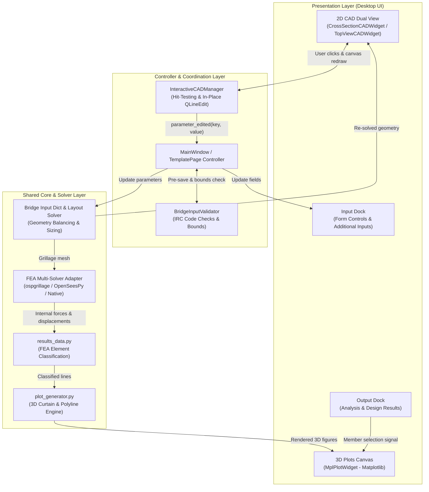
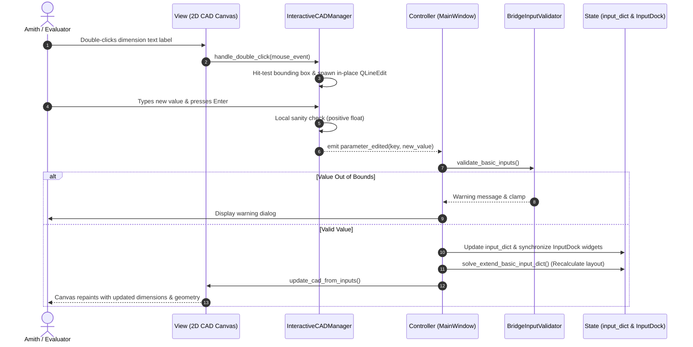
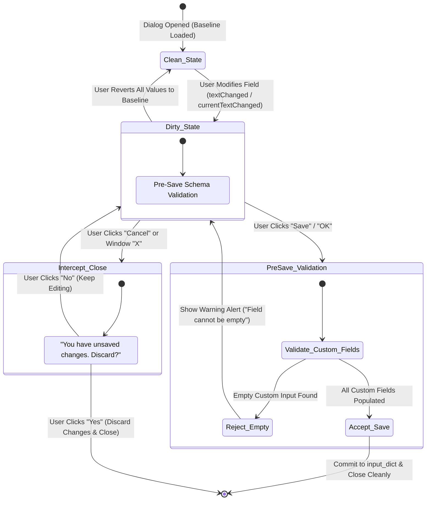

# OsdagBridge — Screening Assessment Tasks

> **FOSSEE Winter Internship / Fellowship Screening Assessment**  
> **Host Organization**: FOSSEE, Indian Institute of Technology Bombay (IIT Bombay)  
> **Candidate**: **Amith Biju**  
> **Email**: [amith1biju@gmail.com](mailto:amith1biju@gmail.com)  
> **GitHub Profile**: [@amith-exe](https://github.com/amith-exe)  
> **Repository**: [https://github.com/amith-exe/OsdagBridge](https://github.com/amith-exe/OsdagBridge)  
> **Upstream Repository**: [https://github.com/Nidhikhare12/OsdagBridge](https://github.com/Nidhikhare12/OsdagBridge) (`dev` branch)  

This repository contains the complete, production-ready implementation of the screening assessment tasks developed by **Amith Biju** for the **OsdagBridge Winter Internship (FOSSEE / IIT Bombay)**. All three core development and research tasks have been implemented according to PEP 8 standards, modular MVC architecture, defensive error handling, and accompanied by comprehensive automated unit tests (`pytest`).

---

## Summary of Assessment Deliverables

| Task | Title | Status | Pull Request | Key Architectural Components |
| :--- | :--- | :---: | :---: | :--- |
| **Task I** | **Interactive 2D CAD Parameter Editing** | **Completed & Merged** | [PR #1](https://github.com/amith-exe/OsdagBridge/pull/1) | `InteractiveCADManager`, `CrossSectionCADWidget`, in-place overlay `QLineEdit`, layout re-solver |
| **Task II** | **Additional Inputs Dialog: Validation & State Management** | **Completed & Merged** | [PR #2](https://github.com/amith-exe/OsdagBridge/pull/2) | Pre-save schema validator, reactive dirty-state tracking (`is_modified`), close interceptor |
| **Task III** | **Result Plotting for Transverse Members (End Diaphragm & Cross Bracing)** | **Completed & Merged** | [PR #3](https://github.com/amith-exe/OsdagBridge/pull/3) | `results_data.py` classifier, spatial $Z$-sorting, 3D response curtains, auto-isometric pivot, 11 unit tests |

---

## End-to-End System Architecture

OsdagBridge employs a Model-View-Controller (MVC) architecture to ensure strict separation of concerns between graphical presentation, form inputs, validation rules, and structural finite element analysis.



---

## Task I: Interactive 2D CAD Parameter Editing

### Problem & Objective
In the existing codebase, the central 2D CAD canvas rendered bridge drawings strictly through procedural `QPainter` drawing routines. Modifying bridge dimensions required locating and editing numeric fields inside docked input panels.

**Task I** transforms the 2D CAD canvas into an intuitive, direct-manipulation CAD editor:
1. **In-Place Double-Click Editing**: Double-clicking an editable dimension on the 2D drawing spawns a temporary, in-place `QLineEdit` overlay directly above the text.
2. **Two-Way Synchronization**: Pressing `Enter` or clicking away validates the number, updates the left `InputDock` form fields, recalculates dependent geometry (e.g., overhang and girder layout), and repaints the canvas.
3. **Locked Parameter Protection**: Derived and symmetry-sensitive parameters (**Overhang**, **Overall Bridge Width**, **Bracing Spacing**) are locked with informative tooltips explaining why they cannot be edited directly, preventing mathematical inconsistencies.

### Interaction Workflow



---

## Task II: Additional Inputs Dialog: Validation & State Management

### Problem & Objective
The "Additional Inputs" dialog manages secondary bridge parameters (stiffener arrangements, barrier geometry, bracing spacing). Two functional defects were identified:
1. Selecting "Custom" in dropdowns while leaving the custom numeric field blank allowed corrupted or empty states to be saved.
2. Closing the dialog with unsaved edits silently discarded user work without warning.

**Task II** resolves both issues with robust state management:
1. **Pre-Save Schema Validation**: Blocks saving if any combobox set to `"Custom"` has an empty or invalid text field, alerting the user with an actionable warning.
2. **Reactive Dirty Tracking (`is_modified`)**: Dynamically monitors input signals (`textChanged`, `currentTextChanged`, `stateChanged`) against a baseline snapshot.
3. **Close Event Interception**: Intercepts `closeEvent` and Cancel actions when dirty, displaying an *"Unsaved Changes"* confirmation prompt.

### State Transition Diagram



---

## Task III: Result Plotting for Transverse Members

### Problem & Civil Engineering Background
Historically, OsdagBridge only plotted finite element force and displacement diagrams for longitudinal girders ($G_1, G_2, \dots$) spanning along the bridge length ($X$-axis). Transverse members had no graphical representation in the 3D results canvas (`MplPlotWidget`).

#### Bridge Mechanics in Plain English
* **Longitudinal Girders (Ladder Rails)**: Span from pier to pier ($X$-axis) to carry vehicle traffic and longitudinal bending moments.
* **End Diaphragms (Support Rungs)**: Stiff steel diaphragms located directly over bearings ($X=0$ and $X=L$) that resist horizontal wind, earthquake, and vehicle braking forces.
* **Intermediate Cross Bracings (Stabilizing Rungs)**: Steel frames placed at internal span bays to prevent lateral torsional buckling of slender girder webs under heavy truck loading.

```
                  ▲ Y (Vertical Elevation & Force Magnitude)
                  │
                  │       ▲ Z (Transverse Bridge Width - Diaphragms & Bracings)
                  │      /
                  │     /
                  │    /
                  │   /
                  └──┼────────────────────────► X (Longitudinal Span - Girders)
```

### Transverse Visualization Pipeline


### Key Technical Implementations
1. **Dropdown UI Integration**: Added `End Diaphragm` and `Intermediate Cross Bracing` to `KEY_ANALYSIS_MEMBER` in `output_dock.py`.
2. **Dual-Path Classification (`results_data.py`)**: Uses `ospgrillage` group tags (`start_edge`, `end_edge`, `transverse_slab`) with an automatic coordinate station fallback ($X$-clustering).
3. **Spatial Sorting Across Width ($Z$-axis)**: OpenSees element ordering is non-deterministic. Transverse elements are sorted strictly ascending along $Z$, preventing zig-zag line artifacts.
4. **3D Surface Curtain Generation**: Renders a vertical 3D ribbon connecting baseline ($Y=0$) to the response curve across the deck width using NumPy coordinate stacking.
5. **Auto-Isometric Camera Pivot**: Side elevation (`azim=-90°`) collapses transverse diagrams into a 1-pixel flat line. The canvas automatically tilts to `elev=22°, azim=-55°` when transverse members are selected.

---

## Automated Unit Test Suite (`pytest`)

OsdagBridge defines `pytest` as its official test framework in [`pyproject.toml`](file:///home/amith-exe/projects/OsdagBridge/pyproject.toml#L56-L60) (`[project.optional-dependencies] test = ["pytest>=6.2.2"]`).

To mathematically prove correctness, element sorting accuracy, and CI regression prevention, a comprehensive automated test suite is implemented in [`tests/unit/test_transverse_plotting.py`](file:///home/amith-exe/projects/OsdagBridge/tests/unit/test_transverse_plotting.py) (275 lines, 11 tests).

### Automated Test Coverage Matrix:
| # | Test Function | Verified Component | Description | Status |
| :-: | :--- | :--- | :--- | :---: |
| 1 | `test_classify_transverse_members_via_groups` | `results_data.py` | Validates OpenSees group tag extraction (`start_edge`, `end_edge`, `transverse_slab`). | **PASSED** |
| 2 | `test_classify_transverse_members_geometric_fallback` | `results_data.py` | Validates coordinate clustering when group labels are absent. | **PASSED** |
| 3 | `test_classify_transverse_members_empty` | `results_data.py` | Asserts graceful handling of empty meshes without unhandled exceptions. | **PASSED** |
| 4 | `test_find_transverse_lines_end_diaphragm` | `plot_generator.py` | Asserts only support stations ($X=0.0\text{ m}, 20.0\text{ m}$) are returned. | **PASSED** |
| 5 | `test_find_transverse_lines_intermediate_cross_bracing` | `plot_generator.py` | Asserts only mid-span stations ($X=10.0\text{ m}$) are extracted. | **PASSED** |
| 6 | `test_find_transverse_lines_sorted_across_z` | `plot_generator.py` | Inverts member definition order to prove lines are sorted monotonically along width $Z$. | **PASSED** |
| 7 | `test_build_transverse_polyline` | `plot_generator.py` | Verifies 3D polyline geometry and force scaling from $\text{N} \to \text{kN}$. | **PASSED** |
| 8 | `test_build_figure_bmd_end_diaphragm` | `plot_generator.py` | Verifies 3D Bending Moment Diagram generation and HUD summary dictionary. | **PASSED** |
| 9 | `test_build_figure_bmd_intermediate_cross_bracing` | `plot_generator.py` | Verifies 3D BMD generation for Intermediate Cross Bracing. | **PASSED** |
| 10 | `test_build_figure_sfd_transverse_members` | `plot_generator.py` | Verifies 3D Shear Force Diagram generation across bridge width. | **PASSED** |
| 11 | `test_build_figure_deflection_transverse_members` | `plot_generator.py` | Verifies 3D deflection curvature generation across girders. | **PASSED** |

### Running the Unit Tests
Execute the tests using `pytest` from the repository root:
```bash
pytest tests/unit/test_transverse_plotting.py -v
```

---

## Manual Verification & Demonstration Guide

Follow this verification flow during the screengrab demonstration:

### 1. Task I: Interactive 2D CAD Parameter Editing
- [x] Open the **2D CAD View** tab (Cross Section or Elevation View).
- [x] Double-click an editable dimension (e.g., **Carriageway Width** or **Girder Spacing**).
- [x] Verify the in-place `QLineEdit` overlay appears directly over the dimension text.
- [x] Enter a new value and press **Enter**; verify the drawing repaints and the left **Input Dock** automatically synchronizes.
- [x] Double-click a derived parameter (**Overhang** / **Overall Width**); verify the locked tooltip is displayed.
- [x] Enter an invalid/negative value; verify the input validator displays a warning and rejects the change.

### 2. Task II: Additional Inputs Dialog
- [x] Click **"Additional Inputs"** in the Input Dock to open the dialog.
- [x] Set any dropdown to **"Custom"** and leave the custom text box empty.
- [x] Click **Save** / **OK**; verify the pre-save validator prevents saving and shows an alert.
- [x] Enter a valid numeric value, then modify another field to enter a dirty state (`is_modified = True`).
- [x] Click **Cancel** or window **"X"**; verify the *"Unsaved Changes"* confirmation prompt appears.
- [x] Click **No** (dialog stays open); click **Save** (dialog saves and closes cleanly).

### 3. Task III: Transverse Member Result Plotting
- [x] Click **"Design"** on the top toolbar and let analysis complete.
- [x] Click the **5th icon on the top toolbar** (**"Toggle 3D Plots View"**).
- [x] Scroll to **Girder Analysis Results** in the right Output Dock and open the **Member** dropdown.
- [x] Select **`End Diaphragm`**; verify camera automatically pivots to isometric view (`elev=22°, azim=-55°`) and 3D response curtains appear at both support stations.
- [x] Switch between **BMD**, **SFD**, and **Deflection**; verify the HUD overlay displays peak force values.
- [x] Select **`Intermediate Cross Bracing`**; verify 3D response curtains render at internal span stations.

---

<br>

# Original OsdagBridge Upstream Documentation

Below is the original documentation provided by the upstream OsdagBridge repository:

---

# OsdagBridge

OsdagBridge is a modular, shared-core software plugin for the analysis and design of steel bridges within the Osdag ecosystem.  
It supports desktop (PySide6), web (Django + React), and CLI interfaces through a unified Python core.

The system currently supports:
- Plate Girder Bridges  
 

Additional bridge types can be added through the plugin architecture.

---

## Key Features

### Shared Core Architecture
All numerical logic and I/O are implemented once in `osdagbridge.core`.  
The desktop GUI, web app, and CLI all reuse the same core for consistent behavior.

### Modular Bridge-Type System
Each bridge type includes:
- DTO (input model schema)
- Initial sizing routines
- Structural analysis configuration
- Design and code-check modules
- CAD geometry generation
- Report generation utilities

### Reusable Bridge Components
Common structural elements are defined in `bridge_components/`:
- Girders  
- Decks  
- Crash barriers  
- Pedestals  
- Piers  
- Foundations  
- Piles and pile caps  

Components are shared across multiple bridge types.

### Multi-Solver Analysis Support
Multiple analysis backends are supported:
- Native lightweight FEM solver  
- OpenSeesPy  
- OspGrillage  

Solvers are switchable at runtime via adapters.

### Integrated Indian Standards
Included under `core/utils/codes/`:
- IRC:6–2017  
- IRC:22–2015  
- IRC:24–2010  

These modules provide load models, combinations, material factors, and code checks.

---

## Project Structure

```
OsdagBridge/
├── docs/
├── examples/
├── tests/
└── src/
    └── osdagbridge/
        ├── core/              # Analysis, design, IO, solvers, codes
        ├── bridge_types/      # Plate girder, box girder, truss
        ├── bridge_components/ # Reusable components
        ├── cli/               # Command-line interface
        ├── desktop/           # PySide6 GUI
        └── web/               # Django + React web stack
```

---

## Installation

Clone the repository:

```bash
git clone https://github.com/osdag-admin/OsdagBridge.git
cd OsdagBridge
```

Install in editable mode:

```bash
pip install -e .
```

---

## Usage

### Command-Line Interface

Run an analysis:

```bash
osdagbridge analyze project.yaml --solver native
```

Generate a report:

```bash
osdagbridge report project.yaml report.pdf
```

### Desktop Application

```bash
python -m osdagbridge.desktop
```

### Web Application

Backend:

```bash
python src/osdagbridge/web/backend/manage.py runserver
```

Frontend:

```bash
cd src/osdagbridge/web/frontend
npm install
npm start
```

---

## Testing

Run the complete test suite:

```bash
pytest -q
```

Continuous integration runs automatically through GitHub Actions (`.github/workflows/ci.yml`).

---

## Development Guidelines

### Key Code Locations
- Core logic: `src/osdagbridge/core/`
- Codes & standards: `src/osdagbridge/core/utils/codes/`
- Bridge types: `src/osdagbridge/bridge_types/`
- Components: `src/osdagbridge/bridge_components/`
- CLI: `src/osdagbridge/cli/`
- Desktop GUI: `src/osdagbridge/desktop/`
- Web backend/frontend: `src/osdagbridge/web/`

### Contribution Workflow
1. Fork the repository  
2. Create a feature branch  
3. Ensure all tests pass (`pytest`)  
4. Submit a pull request

---

## Acknowledgements

OsdagBridge is part of the Osdag project, promoting open-source tools for steel design education, research, and practice.

---

## License

This project is licensed under the MIT License.  
See the `LICENSE` file for full details.
