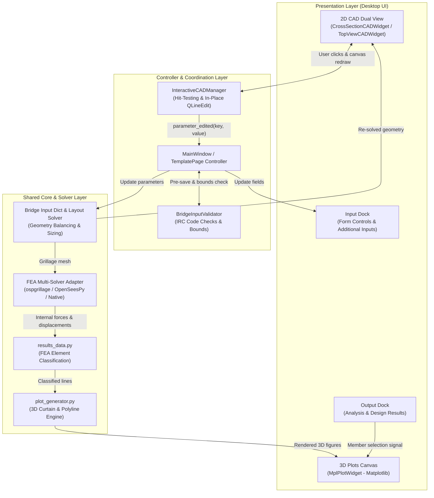
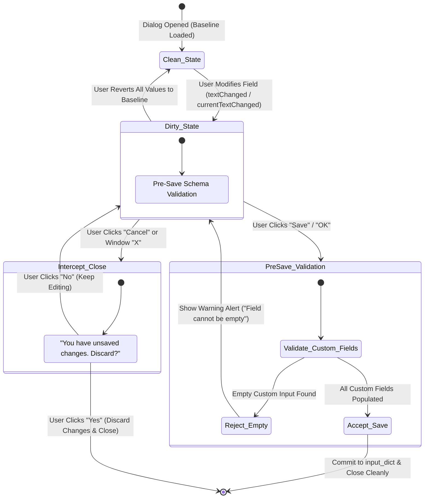
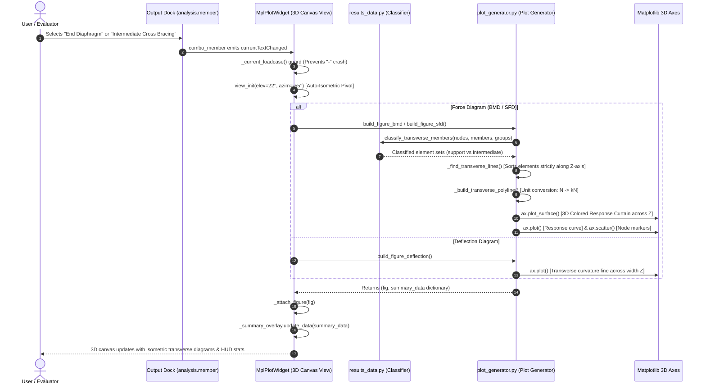

# OsdagBridge — Steel Bridge Analysis & Design Platform

[](https://www.python.org/)
[](https://doc.qt.io/qtforpython/)
[](https://openseespydoc.readthedocs.io/)
[](https://irc.nic.in/)
[](LICENSE)

OsdagBridge is a modular, shared-core structural engineering platform designed for the automated finite element analysis, code compliance checking (IRC / IS), and design optimization of steel highway bridges. Developed as part of the **FOSSEE / Osdag ecosystem at IIT Bombay**, OsdagBridge couples finite element solvers (`OpenSeesPy`, `ospgrillage`, and native FEM) with an interactive desktop interface (PySide6/Qt), command-line tooling, and web services.

This repository branch contains the comprehensive, production-ready implementation of all **Three Core Screening Assessment Tasks**:
1. **Task I: Interactive 2D CAD Parameter Editing** (In-place dynamic overlays, bidirectional sync, locked-parameter guard).
2. **Task II: Additional Inputs Dialog — Validation & State Management** (Pre-save schema validation, reactive dirty-state tracking, unsaved changes interceptor).
3. **Task III: Result Plotting for Transverse Members** (3D response curtains for End Diaphragms & Intermediate Cross Bracings, automatic isometric camera pivot, and automated unit test suite).

---

## Table of Contents
- [System Architecture Overview](#system-architecture-overview)
- [Task I: Interactive 2D CAD Parameter Editing](#task-i-interactive-2d-cad-parameter-editing)
- [Task II: Additional Inputs Dialog — Validation & State Management](#task-ii-additional-inputs-dialog--validation--state-management)
- [Task III: Result Plotting for Transverse Members](#task-iii-result-plotting-for-transverse-members)
- [Automated Unit Test Suite (`pytest`)](#automated-unit-test-suite-pytest)
- [Manual Verification & Demonstration Guide](#manual-verification--demonstration-guide)
- [Quickstart & Installation](#quickstart--installation)
- [Original OsdagBridge Upstream Documentation](#original-osdagbridge-upstream-documentation)

---

## System Architecture Overview

OsdagBridge follows a decoupled **Model-View-Controller (MVC)** design pattern to cleanly separate graphics rendering, UI presentation, input validation, and structural engineering solver logic.



---

## Task I: Interactive 2D CAD Parameter Editing

### Objective & Architectural Challenge
In earlier versions, the central 2D CAD canvas rendered bridge drawings strictly via procedural `QPainter` drawing routines; modifying any parameter required hunting down the corresponding numeric field inside docked panels. 

**Task I** transforms the 2D CAD canvas into an interactive editor:
* Double-clicking an editable dimension on the drawing activates a temporary, in-place `QLineEdit` overlay directly above the text.
* Committing on `Enter` or clicking away triggers validation, synchronizes the docked input panel, recalculates derived bridge geometry (e.g., cantilever overhangs and girder spacing), and automatically repaints the canvas.
* Derived and symmetry-sensitive parameters (**Overhang**, **Overall Bridge Width**, **Bracing Spacing**) are locked with informative tooltips to prevent geometric contradictions.

### Interaction Sequence Flow


### Key Technical Implementations
* **Hit-Testing Engine (`InteractiveCADManager`)**: Dynamically records label bounding boxes (`QRectF`) during the procedural `paintEvent` cycle, expanding hit areas with 6px padding for effortless user interaction.
* **Non-Disruptive Dynamic Overlay**: Spawns a frameless, styled `QLineEdit` precisely positioned over the canvas coordinate, auto-focusing and selecting the numeric text.
* **Separation of Concerns**: The CAD canvas remains a pure visual view; all validation, state persistence, and geometry re-solving are coordinated via Qt signals routed to the central controller.

---

## Task II: Additional Inputs Dialog — Validation & State Management

### Objective & Architectural Challenge
The "Additional Inputs" dialog allows engineers to configure secondary bridge details (cross-frame spacing, stiffener types, crash barrier geometry). Two critical flaws were addressed:
1. When selecting "Custom" for dropdown items, leaving the custom numeric input blank allowed invalid states to be saved.
2. Closing the dialog with unsaved modifications discarded user work silently without warning.

### Dialog State & Lifecycle Workflow



### Key Technical Implementations
* **Pre-Save Schema Validator**: Iterates through all form fields; if any combobox is set to `"Custom"`, it verifies that the paired `QLineEdit` contains non-whitespace, valid numeric input before permitting persistence.
* **Reactive Dirty Tracking (`is_modified`)**: Hooks into Qt input signals (`textChanged`, `currentTextChanged`, `stateChanged`) to dynamically compare live values against baseline snapshot state.
* **Close Event Interception**: Overrides `QWidget.closeEvent` and the `reject()` lifecycle method to prompt the user with a confirmation dialog before destroying unsaved data.

---

## Task III: Result Plotting for Transverse Members

### Objective & Civil Engineering Background
Historically, OsdagBridge only plotted finite element force and displacement diagrams for longitudinal girders ($G_1, G_2, \dots$). **Task III** expands 3D visualization to transverse structural elements (**End Diaphragms** and **Intermediate Cross Bracings**).

#### Civil Engineering in Plain English
* **Girders (Longitudinal Rails)**: Span lengthwise from support to support ($X$-axis) to carry primary traffic bending moments.
* **End Diaphragms (Support Rungs)**: Stiff steel diaphragms located directly over bearings ($X=0$ and $X=L$) that resist horizontal wind, earthquake, and vehicle braking forces.
* **Intermediate Cross Bracings (Stabilizing Rungs)**: X-frames placed at mid-span stations to prevent lateral torsional buckling of slender girder webs under heavy truck loads.

```
                  ▲ Y (Vertical Elevation & Force Magnitude)
                  │
                  │       ▲ Z (Transverse Bridge Width - Diaphragms & Bracings)
                  │      /
                  │     /
                  │    /
                  │   /
                  └──┼────────────────────────► X (Longitudinal Span - Girders)
```

### Transverse Visualization Pipeline



### Key Technical Implementations
* **Member Dropdown Integration**: Populates `KEY_ANALYSIS_MEMBER` with `End Diaphragm` and `Intermediate Cross Bracing` under *Girder Analysis Results*.
* **Dual-Path Element Classification (`results_data.py`)**: Uses `ospgrillage` group labels (`start_edge`, `end_edge`, `transverse_slab`) when available, backed by an automatic geometric coordinate clustering algorithm ($X$-station grouping).
* **Spatial Sorting Across Width ($Z$-axis)**: OpenSees element ordering is non-deterministic. Elements within each transverse line are sorted ascending by $Z$-coordinate, eliminating zig-zag plot artifacts.
* **3D Surface Curtain Generation**: Renders a vertical 3D ribbon connecting baseline ($Y=0$) to the response curve across the full deck width using NumPy coordinate stacking.
* **Auto-Isometric Camera Pivot**: The default side-elevation camera (`azim=-90°`) collapses transverse diagrams into a 1-pixel flat line. The canvas automatically tilts to `elev=22°, azim=-55°` when transverse members are chosen.
* **HUD Overlay Integration**: Extracts local extrema to display maximum and minimum bending moments, shears, and deflections for every transverse station.

---

## Automated Unit Test Suite (`pytest`)

OsdagBridge configures `pytest` as its official test framework in `pyproject.toml` (`[project.optional-dependencies] test = ["pytest>=6.2.2"]`).

To mathematically prove correctness, element sorting accuracy, and CI regression prevention, a comprehensive automated test suite is implemented in [`tests/unit/test_transverse_plotting.py`](file:///home/amith-exe/projects/OsdagBridge/tests/unit/test_transverse_plotting.py) (275 lines, 11 tests).

### Automated Test Coverage Matrix:
| # | Test Function | Verified Component | Description |
| :-: | :--- | :--- | :--- |
| 1 | `test_classify_transverse_members_via_groups` | `results_data.py` | Validates OpenSees group tag extraction (`start_edge`, `end_edge`, `transverse_slab`). |
| 2 | `test_classify_transverse_members_geometric_fallback` | `results_data.py` | Validates coordinate clustering when group labels are absent. |
| 3 | `test_classify_transverse_members_empty` | `results_data.py` | Asserts graceful handling of empty meshes without unhandled exceptions. |
| 4 | `test_find_transverse_lines_end_diaphragm` | `plot_generator.py` | Asserts only support stations ($X=0.0\text{ m}, 20.0\text{ m}$) are returned. |
| 5 | `test_find_transverse_lines_intermediate_cross_bracing` | `plot_generator.py` | Asserts only mid-span stations ($X=10.0\text{ m}$) are extracted. |
| 6 | `test_find_transverse_lines_sorted_across_z` | `plot_generator.py` | Inverts member definition order to prove lines are sorted monotonically along width $Z$. |
| 7 | `test_build_transverse_polyline` | `plot_generator.py` | Verifies 3D polyline geometry and force scaling from $\text{N} \to \text{kN}$. |
| 8 | `test_build_figure_bmd_end_diaphragm` | `plot_generator.py` | Verifies 3D Bending Moment Diagram generation and HUD summary dictionary. |
| 9 | `test_build_figure_bmd_intermediate_cross_bracing` | `plot_generator.py` | Verifies 3D BMD generation for Intermediate Cross Bracing. |
| 10 | `test_build_figure_sfd_transverse_members` | `plot_generator.py` | Verifies 3D Shear Force Diagram generation across bridge width. |
| 11 | `test_build_figure_deflection_transverse_members` | `plot_generator.py` | Verifies 3D deflection curvature generation across girders. |

### Running the Unit Tests
Execute the tests using `pytest` from the repository root:
```bash
pytest tests/unit/test_transverse_plotting.py -v
```

---

## Manual Verification & Demonstration Guide

For the screengrab video demonstration, follow this step-by-step checklist:

### 1. Task I: Interactive 2D CAD Parameter Editing
- [x] Open the **2D CAD View** tab (Cross Section or Elevation View).
- [x] Double-click an editable dimension (e.g., **Carriageway Width** or **Girder Spacing**).
- [x] Verify the in-place `QLineEdit` overlay appears directly over the dimension text.
- [x] Enter a new value and press **Enter**; verify the drawing repaints and the left **Input Dock** automatically synchronizes.
- [x] Double-click a derived parameter (**Overhang** / **Overall Width**); verify the locked tooltip is displayed.
- [x] Enter an invalid/negative value; verify the input validator displays a warning and rejects the change.

### 2. Task II: Additional Inputs Dialog
- [x] Click **"Additional Inputs"** in the Input Dock to open the dialog.
- [x] Set any dropdown to **"Custom"** and leave the custom text box empty.
- [x] Click **Save** / **OK**; verify the pre-save validator prevents saving and shows an alert.
- [x] Enter a valid numeric value, then modify another field to enter a dirty state (`is_modified = True`).
- [x] Click **Cancel** or window **"X"**; verify the *"Unsaved Changes"* confirmation prompt appears.
- [x] Click **No** (dialog stays open); click **Save** (dialog saves and closes cleanly).

### 3. Task III: Transverse Member Result Plotting
- [x] Click **"Design"** on the top toolbar and let analysis complete.
- [x] Click the **5th icon on the top toolbar** (**"Toggle 3D Plots View"**).
- [x] Scroll to **Girder Analysis Results** in the right Output Dock and open the **Member** dropdown.
- [x] Select **`End Diaphragm`**; verify camera automatically pivots to isometric view (`elev=22°, azim=-55°`) and 3D response curtains appear at both support stations.
- [x] Switch between **BMD**, **SFD**, and **Deflection**; verify the HUD overlay displays peak force values.
- [x] Select **`Intermediate Cross Bracing`**; verify 3D response curtains render at internal span stations.

---

## Quickstart & Installation

### Environment Setup
Clone the repository and install in editable mode:
```bash
git clone https://github.com/amith-exe/OsdagBridge.git
cd OsdagBridge
pip install -e .
```

To install test dependencies:
```bash
pip install -e .[test]
```

### Launching the Desktop Application
```bash
python -m osdagbridge.desktop
```

---

# Original OsdagBridge Upstream Documentation

Below is the original documentation provided by the upstream OsdagBridge repository:

---

# OsdagBridge

OsdagBridge is a modular, shared-core software plugin for the analysis and design of steel bridges within the Osdag ecosystem.  
It supports desktop (PySide6), web (Django + React), and CLI interfaces through a unified Python core.

The system currently supports:
- Plate Girder Bridges  
 

Additional bridge types can be added through the plugin architecture.

---

## Key Features

### Shared Core Architecture
All numerical logic and I/O are implemented once in `osdagbridge.core`.  
The desktop GUI, web app, and CLI all reuse the same core for consistent behavior.

### Modular Bridge-Type System
Each bridge type includes:
- DTO (input model schema)
- Initial sizing routines
- Structural analysis configuration
- Design and code-check modules
- CAD geometry generation
- Report generation utilities

### Reusable Bridge Components
Common structural elements are defined in `bridge_components/`:
- Girders  
- Decks  
- Crash barriers  
- Pedestals  
- Piers  
- Foundations  
- Piles and pile caps  

Components are shared across multiple bridge types.

### Multi-Solver Analysis Support
Multiple analysis backends are supported:
- Native lightweight FEM solver  
- OpenSeesPy  
- OspGrillage  

Solvers are switchable at runtime via adapters.

### Integrated Indian Standards
Included under `core/utils/codes/`:
- IRC:6–2017  
- IRC:22–2015  
- IRC:24–2010  

These modules provide load models, combinations, material factors, and code checks.

---

## Project Structure

```
OsdagBridge/
├── docs/
├── examples/
├── tests/
└── src/
    └── osdagbridge/
        ├── core/              # Analysis, design, IO, solvers, codes
        ├── bridge_types/      # Plate girder, box girder, truss
        ├── bridge_components/ # Reusable components
        ├── cli/               # Command-line interface
        ├── desktop/           # PySide6 GUI
        └── web/               # Django + React web stack
```

---

## Installation

Clone the repository:

```bash
git clone https://github.com/osdag-admin/OsdagBridge.git
cd OsdagBridge
```

Install in editable mode:

```bash
pip install -e .
```

---

## Usage

### Command-Line Interface

Run an analysis:

```bash
osdagbridge analyze project.yaml --solver native
```

Generate a report:

```bash
osdagbridge report project.yaml report.pdf
```

### Desktop Application

```bash
python -m osdagbridge.desktop
```

### Web Application

Backend:

```bash
python src/osdagbridge/web/backend/manage.py runserver
```

Frontend:

```bash
cd src/osdagbridge/web/frontend
npm install
npm start
```

---

## Testing

Run the complete test suite:

```bash
pytest -q
```

Continuous integration runs automatically through GitHub Actions (`.github/workflows/ci.yml`).

---

## Development Guidelines

### Key Code Locations
- Core logic: `src/osdagbridge/core/`
- Codes & standards: `src/osdagbridge/core/utils/codes/`
- Bridge types: `src/osdagbridge/bridge_types/`
- Components: `src/osdagbridge/bridge_components/`
- CLI: `src/osdagbridge/cli/`
- Desktop GUI: `src/osdagbridge/desktop/`
- Web backend/frontend: `src/osdagbridge/web/`

### Contribution Workflow
1. Fork the repository  
2. Create a feature branch  
3. Ensure all tests pass (`pytest`)  
4. Submit a pull request

---

## Acknowledgements

OsdagBridge is part of the Osdag project, promoting open-source tools for steel design education, research, and practice.

---

## License

This project is licensed under the MIT License.  
See the `LICENSE` file for full details.
